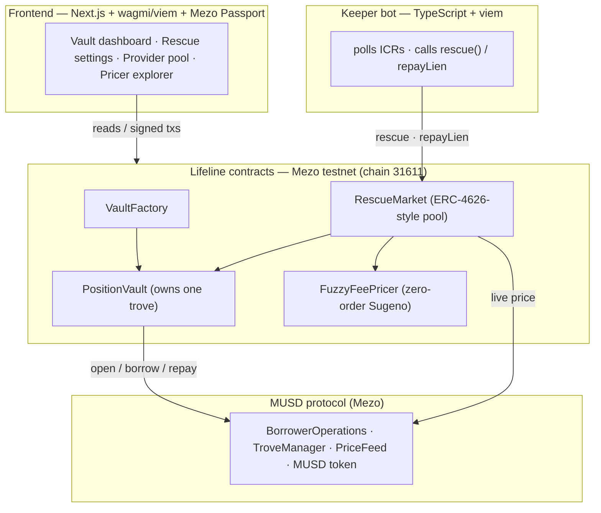

# Lifeline

**A rescue market that stops MUSD borrowers on Mezo from being liquidated.** When a
Bitcoin-backed loan nears its liquidation threshold, backstop providers repay part of it and
take a short-term *senior claim* on the borrower's BTC — priced on-chain by a fuzzy-logic risk
model. The borrower keeps their Bitcoin and its upside; the provider earns a fee.

Built for the [AKINDO × Mezo Buildathon](https://app.akindo.io/wave-hacks/OVOO0gdrVU8379D10)
(Track 1 — DeFi). Deployed and verified on **Mezo testnet**.

---

## The problem

An MUSD loan (a *trove*) is liquidated once its collateral ratio (ICR) falls below **110%**.
Liquidation costs the borrower up to ~10% of their collateral **and all of its future upside**.
Today the only defence is watching your own position and topping it up in time.

Worse, **nobody can rescue someone else's loan.** MUSD's `addColl` only credits the caller's own
trove, and its signature-based delegation is one-shot and fixed-amount. There is no native way for
a third party to inject capital into an at-risk position. Lifeline builds that missing primitive.

## How it works

1. Each borrower's trove is owned by their own **PositionVault** contract (one trove per address → one vault per position).
2. The borrower opts in with rescue terms: **trigger ICR**, **target ICR**, and **max rescue size**.
3. **Rescue providers** deposit MUSD into the shared **RescueMarket** pool and earn fees.
4. When a vault's ICR drops below its trigger, **anyone** (a keeper) calls `rescue(vault)`. The
   market repays just enough MUSD to restore the target ICR.
5. The vault records a **lien** (repaid amount + fee + keeper tip). While the lien is active, the
   borrower cannot withdraw collateral, borrow more, or close — until they repay the rescue.
6. The fee is set by an on-chain **fuzzy inference pricer** whose rule table is committed at
   deployment: riskier rescues (lower ICR, bigger size, weaker system health) cost more, from **1% to 10%**.

The rescue and the lien are credible only because a contract enforces them — there is no
off-chain equivalent without a legal agreement.

## Architecture



No backend, database or indexer: **the chain is the database** and the keeper is the only
off-chain process. See [docs/architecture.md](docs/architecture.md) for the full design,
invariants, and risk analysis.

## Why Mezo

Lifeline hooks directly into MUSD's trove, liquidation and redemption mechanics — it reads the
live `PriceFeed`, sizes rescues against `TroveManager` state, and respects MUSD's `minNetDebt`
and Recovery-Mode rules. It is a composable layer *on top of* Mezo's existing lending
infrastructure, not a standalone app. BTC is the native gas and collateral throughout.

## Deployed addresses (Mezo testnet · chain 31611)

| Contract | Address |
|---|---|
| FuzzyFeePricer | [`0x3589A3D60FE9F9A4038933222B3e5fd8680aDE43`](https://explorer.test.mezo.org/address/0x3589A3D60FE9F9A4038933222B3e5fd8680aDE43) |
| VaultFactory | [`0x1fF92E9f5557cb684aDd38fbd6EFbe99FeAd9Dac`](https://explorer.test.mezo.org/address/0x1fF92E9f5557cb684aDd38fbd6EFbe99FeAd9Dac) |
| RescueMarket | [`0xbd145bA00b75cE417e94832B857A93Af7eBB1a75`](https://explorer.test.mezo.org/address/0xbd145bA00b75cE417e94832B857A93Af7eBB1a75) |

All three are verified on Blockscout. MUSD protocol addresses are pinned in
[`deployments/testnet.json`](deployments/testnet.json).

## Repository layout

```
liq-engine/
├─ contracts/   Foundry project — VaultFactory, PositionVault, RescueMarket, FuzzyFeePricer
├─ keeper/      TypeScript + viem keeper bot (watch + rescue)
├─ web/         Next.js app — vault dashboard, provider pool, pricer explorer
├─ deployments/ our addresses + pinned MUSD addresses (testnet.json)
└─ docs/        project overview, architecture, standards, progress tracker
```

## Running it

Full instructions, network details and env setup are in [docs/setup.md](docs/setup.md).
Prerequisites: Node 20+, pnpm, [Foundry](https://getfoundry.sh/), a **testnet-only** wallet.

**Contracts** (`contracts/`)
```bash
forge build && forge test                 # unit + fuzz tests
FOUNDRY_PROFILE=fork forge test           # fork tests vs Mezo testnet (oracle mock)
```

**Keeper** (`keeper/`)
```bash
pnpm install
pnpm start                                # DRY RUN: logs rescues it would make, sends nothing
pnpm start:live                           # LIVE: sends from KEEPER_PRIVATE_KEY (testnet wallet)
```

**Web** (`web/`)
```bash
pnpm install
cp .env.example .env.local                # set NEXT_PUBLIC_WALLETCONNECT_PROJECT_ID
pnpm dev                                   # http://localhost:3000
```

## Scope

**Wave 1 (this submission)** — a deployed, demoable rescue flow on Mezo testnet:
VaultFactory + PositionVault, the RescueMarket pool, the **FuzzyFeePricer**, a keeper bot, and a
web app including an interactive **pricer explorer**.

> **Wave 1 limitation (stated plainly):** there is **no seizure** yet. An unpaid lien keeps the
> borrower's collateral locked, but the pool cannot force-claim the BTC, and if the trove is later
> liquidated the providers bear the loss. Seizure (`claimLien`), with the partial-seizure ceiling
> and strategic-default safeguards analysed in [docs/architecture.md §5](docs/architecture.md), is
> Wave 2 work.

**Wave 2 (planned)** — seizure / `claimLien`; a **GNPricer** (Generalized Neuron) behind the same
`IFeePricer` interface (the "fuzzy → neural" upgrade); tradeable positions (ERC-721) and ERC-4626
provider shares; an invariant suite and Slither pass; redemption-aware pricing.

## License

MIT — testnet software, provided as-is. Never deploy to Mezo mainnet without an audit.
